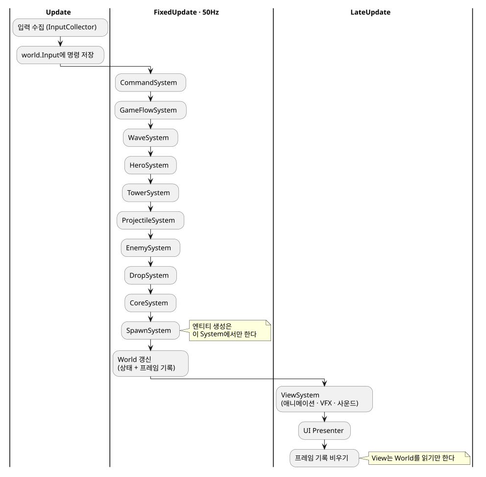

# project_05

플레이어가 히어로를 직접 움직이며 싸우고, 번 골드로 타워를 세우고, 필요할 때 타워에 탑승해 직접 사격하며 기지를 지키는 액션 타워 디펜스. 스테이지는 무한이며 도달한 웨이브와 점수가 기록이 된다.

**[▶ 브라우저에서 바로 플레이](https://to-steak.github.io/project05/)** 

## 이 프로젝트에 대해

"코딩 에이전트를 활용하면 24시간 안에 목표한 게임을 완성할 수 있는가"를 확인하기 위한 실험 프로젝트입니다. 코드는 Claude가, Unity 에디터 작업은 제가 맡아 3일에 걸쳐 체감 작업 시간 약 24시간 동안 제작했습니다.

- 설계 시작부터 약 6.5시간 만에 처음부터 패배까지 플레이 가능한 핵심 루프 완성
- 폴리싱 단계(타워 모델, 씬 장식, 포스트 프로세싱, 시작 화면, UI 연출)는 미완성
- 병목은 코드가 아닌 사람이 하는 에디터 작업이었음

과정과 분석은 Notion 회고에 정리했습니다.
**[프로젝트 회고 (Notion)](https://coherent-grade-1bf.notion.site/24-4053fc64bd03804ca8e8c6353ef197bb?source=copy_link)**

## 구조

ECS 패키지 없이 ECS 철학만 순수 C#으로 따랐습니다.

- **World:** 한 판의 모든 상태를 담는 데이터
- **System:** 고정 50Hz 틱마다 정해진 순서로 World를 갱신하는 static 함수
- **프레임 기록:** 이벤트 대신, 그 틱에 일어난 일을 구조체로 남김
- **ViewSystem:** LateUpdate에서 World와 기록을 읽어 연출만 담당

## 환경

- 엔진: Unity 6 (6000.3.11f1), URP, Input System, Cinemachine 3, AI Navigation
- 타겟: WebGL (GitHub Pages 배포)
- Unity 프로젝트 루트: `Project/`

> **에셋 안내:** 라이선스를 고려해 원본 모델·애니메이션·사운드 에셋은 저장소에 포함하지 않았습니다. 클론해서 열면 해당 리소스가 빠진 상태로 보입니다. 완성된 결과물은 위 플레이 링크에서 확인할 수 있습니다.

## 문서

Claude와 협업할 때 기준으로 삼은 문서입니다.

| 문서 | 내용 |
|---|---|
| [CLAUDE.md](CLAUDE.md) | Claude가 지킬 아키텍처 규칙과 작업 방식 |
| [DESIGN.md](DESIGN.md) | 게임 설계와 아키텍처 상세 |
| [CONVENTIONS.md](CONVENTIONS.md) | 코드 컨벤션, 커밋·브랜치·PR 규칙 |
| [ROADMAP.md](ROADMAP.md) | 작업 순서와 진행 상태 |

## License

프로젝트에 사용한 아래 에셋들은 [Unity Asset Store](https://assetstore.unity.com/)에서 배포되며, [Unity Asset Store Terms of Service and EULA](https://unity.com/legal/as-terms)에 따라 라이선스가 적용됩니다. 라이선스에 따라 원본 에셋은 저장소에 포함하지 않았습니다.

- [RPG Tiny Hero Duo PBR Polyart](https://assetstore.unity.com/packages/3d/characters/humanoids/rpg-tiny-hero-duo-pbr-polyart-225148) - by [Dungeon Mason](https://assetstore.unity.com/publishers/23554)
- [RPG Monster Duo PBR Polyart](https://assetstore.unity.com/packages/3d/characters/creatures/rpg-monster-duo-pbr-polyart-157762) - by [Dungeon Mason](https://assetstore.unity.com/publishers/23554)
- [Party Monster Duo Polyart PBR](https://assetstore.unity.com/packages/3d/characters/creatures/party-monster-duo-polyart-pbr-195698) - by [Dungeon Mason](https://assetstore.unity.com/publishers/23554)
- [RPG Monster Buddy PBR Polyart](https://assetstore.unity.com/packages/3d/characters/creatures/rpg-monster-buddy-pbr-polyart-253961) - by [Dungeon Mason](https://assetstore.unity.com/publishers/23554)
- [RPG Monster Couple PBR Polyart](https://assetstore.unity.com/packages/3d/characters/creatures/rpg-monster-couple-pbr-polyart-355988) - by [Dungeon Mason](https://assetstore.unity.com/publishers/23554)
- [RPG Monster Partners PBR Polyart](https://assetstore.unity.com/packages/3d/characters/creatures/rpg-monster-partners-pbr-polyart-168251) - by [Dungeon Mason](https://assetstore.unity.com/publishers/23554)
- [8Bit Music - 062022](https://assetstore.unity.com/packages/audio/music/8bit-music-062022-225623) - by [GWriterStudio](https://assetstore.unity.com/publishers/27610)
- [FREE Casual Game SFX Pack](https://assetstore.unity.com/packages/audio/sound-fx/free-casual-game-sfx-pack-54116) - by [Dustyroom](https://assetstore.unity.com/publishers/16150)
- [Simple FX - Cartoon Particles](https://assetstore.unity.com/packages/vfx/particles/simple-fx-cartoon-particles-67834) - by [Synty Studios](https://assetstore.unity.com/publishers/5217)

아래 에셋은 [Creative Commons Zero, CC0](https://creativecommons.org/publicdomain/zero/1.0/) License가 적용됩니다.

- [Nature Kit 2.1](https://opengameart.org/content/nature-kit) - by [Kenney](https://www.patreon.com/cw/kenney) ([License](./License/Nature%20Kit%20(2.1)-License.txt))
- [Input Prompts 1.5A](https://kenney.nl/assets/input-prompts) - by [Kenney](https://www.patreon.com/cw/kenney) ([License](./License/Input%20Prompts%20(1.5A)-License.txt))
- [UI Pack - Adventure 1.1](https://kenney.nl/assets/ui-pack-adventure) - by [Kenney](https://www.patreon.com/cw/kenney) ([License](./License/UI%20Pack%20-%20Adventure%20(1.1)-License.txt))
- [Cursor Pack](https://kenney.nl/assets/cursor-pack) - by [Kenney](https://www.patreon.com/cw/kenney)([License](./License/Cursor%20Pack%20(1.1)-License.txt))

아래 폰트는 [SIL Open Font License 1.1](./License/DNFBitBitTTF-License.txt)이 적용됩니다.

- [던파 비트비트체](https://df.nexon.com/data/font/dnfbitbit) - by [Neople](https://www.neople.co.kr)